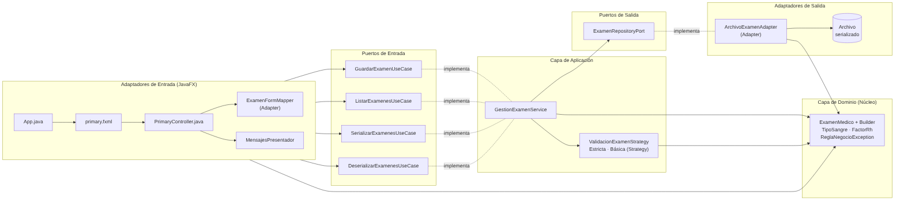

# Exámenes de Sangre — Registro de Examen (JavaFX · Arquitectura Hexagonal)

Aplicación de escritorio para registrar exámenes de sangre de pacientes. Permite **guardar**, **listar**, **serializar** a archivo, **deserializar** desde archivo y **limpiar** el formulario.

El proyecto implementa y refactoriza la solución con **Arquitectura Hexagonal (Puertos y Adaptadores)** y **tres patrones de diseño GoF**.

## Contenido

- [Diagnóstico breve](#diagnóstico-breve)
- [Arquitectura hexagonal](#arquitectura-hexagonal)
- [Patrones GoF implementados](#patrones-gof-implementados)
- [Estructura del proyecto](#estructura-del-proyecto)
- [Requisitos](#requisitos)
- [Configuración](#configuración)
- [Compilar, probar, JavaDoc y ejecutar](#compilar-probar-javadoc-y-ejecutar)
- [Uso de la aplicación](#uso-de-la-aplicación)
- [Calidad de código (SonarQube)](#calidad-de-código-sonarqube)
- [Documentación adicional](#documentación-adicional)

## Diagnóstico breve

Detalle completo en [`docs/01-analisis.md`](docs/01-analisis.md).

| Dimensión | Problema en el original | Solución aplicada |
|---|---|---|
| Acoplamiento | Único lugar para la lógica era el controlador JavaFX; reglas duplicadas en el FXML; escena en campo estático. | Núcleo desacoplado de la GUI mediante puertos y adaptadores. |
| Cohesión | El controlador acumulaba formulario, validación, almacenamiento, archivo y mensajes. | Separación en capas de dominio, casos de uso y adaptadores especializados. |
| Extensibilidad | Sin interfaces: añadir reglas o cambiar el formato de persistencia obligaba a reescribir la UI. | Patrones Strategy y Adapter con interfaces intercambiables. |
| Mantenibilidad | No testeable sin toolkit gráfico, configuración inconsistente, sin pruebas ni JavaDoc. | 115 pruebas unitarias, JavaDoc completo y configuración Maven estandarizada. |

## Arquitectura hexagonal



El núcleo (`domain` + `application`) **no depende** de JavaFX ni de `java.io`. Habla con el exterior por puertos; los adaptadores de `infrastructure` los implementan. Detalle y decisiones en [`docs/02-arquitectura-hexagonal.md`](docs/02-arquitectura-hexagonal.md).

## Patrones GoF implementados

| Categoría | Patrón | Dónde | Propósito |
|---|---|---|---|
| Creacional | **Builder** | `ExamenMedico.Builder` | Crear exámenes válidos con invariantes y verificación centralizada en `build()`. |
| Estructural | **Adapter** | `ArchivoExamenAdapter`, `ExamenFormMapper` | Adaptar la API de archivos al puerto `ExamenRepositoryPort` y la pantalla al dominio. |
| Comportamiento | **Strategy** | `ValidacionExamenStrategy` (`Basica`, `Estricta`) | Validación intercambiable y configurable sin condicionales en el servicio ni controlador. |

Problema, justificación, UML y beneficios de cada uno en [`docs/03-patrones-gof.md`](docs/03-patrones-gof.md).

## Estructura del proyecto

```
parcial3-main/
├── README.md
├── docs/
│   ├── 01-analisis.md
│   ├── 02-arquitectura-hexagonal.md
│   ├── 03-patrones-gof.md
│   ├── diagramas/                 (*.mmd = fuente Mermaid, *.png = renderizado)
│   └── wiki/Analisis-SonarQube.md
└── Examen2/
    ├── pom.xml
    ├── sonar-project.properties
    ├── docker-compose.sonarqube.yml
    └── src/
        ├── main/java/co/edu/poli/Examen2/
        │   ├── domain/            model (ExamenMedico, TipoSangre, FactorRh) · exception (ReglaNegocioException)
        │   ├── application/       port/in · port/out · strategy · usecase (GestionExamenService) · exception
        │   └── infrastructure/    adapter/in/javafx · adapter/out/file · config
        ├── main/resources/        application.properties · co/edu/poli/Examen2/primary.fxml
        └── test/java/...          pruebas unitarias (misma estructura de paquetes)
```

## Requisitos

| Herramienta | Versión |
|---|---|
| JDK | **17 o superior** (probado con 21 y 25) |
| Maven | 3.8 o superior |
| JavaFX | Gestionado por Maven (`org.openjfx` 21.0.5) |

## Configuración

`Examen2/src/main/resources/application.properties`:

| Propiedad | Por defecto | Descripción |
|---|---|---|
| `persistencia.archivo` | `data/examenes.dat` | Archivo de serialización (relativo al directorio de ejecución). |
| `validacion.modo` | `estricta` | Política de validación: `estricta` o `basica`. |

Se pueden sobrescribir al ejecutar: `mvn javafx:run -Dvalidacion.modo=basica -Dpersistencia.archivo=/tmp/examenes.dat`

**Políticas de validación:**

| Regla | `basica` | `estricta` |
|---|---|---|
| Código | 3 a 20 caracteres | Formato `AAA-123` (3 letras, guion, ≥ 3 dígitos) |
| Nombre | 3 a 100 caracteres | Solo letras, espacios, `.`, `'` y `-` |
| Costo | > 0 | ≤ 100 000 000 y máximo 2 decimales |

## Compilar, probar, JavaDoc y ejecutar

Desde el directorio `Examen2/`:

```bash
mvn clean compile            # Compilar código fuente
mvn clean test               # Ejecutar 115 pruebas unitarias + cobertura JaCoCo
mvn javadoc:javadoc          # Generar JavaDoc en target/site/apidocs/index.html
mvn clean javafx:run         # Ejecutar aplicación de escritorio
```

## Uso de la aplicación

1. Completar código (p. ej. `EXM-001`), nombre, costo, tipo de sangre y factor RH.
2. **Guardar:** Registra el examen validando todas las reglas. Si hay errores, se notifican en el área de mensajes.
3. **Listar:** Muestra todos los exámenes registrados en memoria.
4. **Serializar:** Guarda la colección en el archivo binario configurado.
5. **Deserializar:** Carga los registros del archivo persistido.
6. **Limpiar:** Restablece el formulario a su estado inicial.

## Calidad de código (SonarQube)

El proyecto incorpora las directrices de Clean Code y análisis estático de SonarQube:

- **Gestión segura de recursos:** Bloques *try-with-resources* en adaptadores de persistencia.
- **Deserialización segura:** Filtro `ObjectInputFilter` de lista blanca para prevenir inyección de objetos.
- **Código limpio:** 0 variables no utilizadas, sin bloques `catch` vacíos, compilación con `-Xlint:all`.
- **Cobertura de pruebas:** Cobertura JaCoCo sobre domain, application y adaptadores.
- **Documentación técnica:** JavaDoc completo y verificado sin advertencias.

## Documentación adicional

- [`docs/01-analisis.md`](docs/01-analisis.md) — Análisis de arquitectura, acoplamiento y cohesión.
- [`docs/02-arquitectura-hexagonal.md`](docs/02-arquitectura-hexagonal.md) — Estructura de paquetes, puertos y adaptadores.
- [`docs/03-patrones-gof.md`](docs/03-patrones-gof.md) — Justificación y diseño de patrones Builder, Adapter y Strategy.
- [`docs/diagramas/`](docs/diagramas) — Diagramas UML en formato Mermaid y PNG renderizado.
- [`docs/wiki/Analisis-SonarQube.md`](docs/wiki/Analisis-SonarQube.md) — Resumen de estándares de calidad SonarQube.
