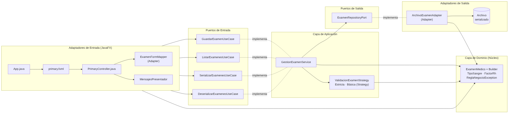
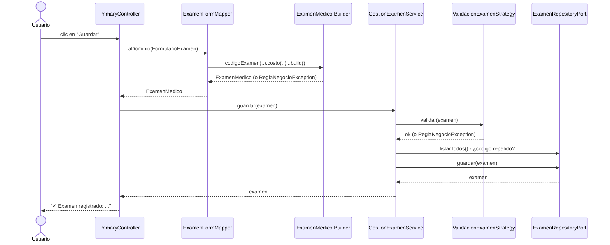

# 2. Arquitectura hexagonal (Puertos y Adaptadores)

## 2.1 Idea

El **núcleo** (`domain` + `application`) no conoce JavaFX ni `java.io`. Habla con el exterior solo mediante **puertos** (interfaces). Los **adaptadores** (`infrastructure`) traducen entre el mundo exterior y esos puertos.



## 2.2 Estructura de paquetes

```
co.edu.poli.Examen2
├── domain                                  ← DOMINIO: entidades y reglas de negocio
│   ├── model
│   │   ├── ExamenMedico                    entidad inmutable + Builder anidado     [Builder]
│   │   ├── TipoSangre                      enum A, B, AB, O
│   │   └── FactorRh                        enum POSITIVO, NEGATIVO
│   └── exception
│       └── ReglaNegocioException
│
├── application                             ← APLICACIÓN
│   ├── port
│   │   ├── in                              PUERTOS DE ENTRADA (qué ofrece el sistema)
│   │   │   ├── GuardarExamenUseCase
│   │   │   ├── ListarExamenesUseCase
│   │   │   ├── SerializarExamenesUseCase
│   │   │   └── DeserializarExamenesUseCase
│   │   └── out                             PUERTOS DE SALIDA (qué necesita el sistema)
│   │       └── ExamenRepositoryPort
│   ├── strategy                                                                    [Strategy]
│   │   ├── ValidacionExamenStrategy
│   │   ├── ValidacionBasicaStrategy
│   │   └── ValidacionEstrictaStrategy
│   ├── usecase
│   │   └── GestionExamenService            implementa los 4 casos de uso
│   └── exception
│       └── PersistenciaException
│
└── infrastructure
    ├── adapter
    │   ├── in.javafx                       ← ADAPTADORES DE ENTRADA (GUI)
    │   │   ├── App                         arranque JavaFX
    │   │   ├── PrimaryController           eventos de botones → puertos de entrada
    │   │   ├── ExamenFormMapper            formulario → dominio                    [Adapter]
    │   │   ├── FormularioExamen            datos crudos de la pantalla (record)
    │   │   └── MensajesPresentador         resultado → texto (sin JavaFX)
    │   └── out.file                        ← ADAPTADORES DE SALIDA
    │       ├── ArchivoExamenAdapter        implementa ExamenRepositoryPort         [Adapter]
    │       └── ExamenRegistro              DTO serializable
    └── config                              ← COMPOSICIÓN / ENSAMBLAJE
        ├── ComposicionRaiz                 único lugar que hace `new` de adaptadores y estrategias
        └── ConfiguracionAplicacion         application.properties + -D
```

Recursos: `src/main/resources/co/edu/poli/Examen2/primary.fxml` y `src/main/resources/application.properties`.

## 2.3 Regla de dependencias

```
infrastructure ──► application ──► domain
(el núcleo nunca importa infrastructure, javafx ni java.io / java.nio)
```

Comprobado con `grep` sobre `domain/` y `application/`: cero imports de `javafx.*`, `java.io.*`, `java.nio.*` o `infrastructure.*`.

## 2.4 Correspondencia con lo solicitado

| Requisito | Dónde está |
|---|---|
| Dominio: entidades y reglas | `domain.model`, `domain.exception` |
| Puertos de entrada | `application.port.in` |
| Puertos de salida | `application.port.out` |
| Aplicación: casos de uso | `application.usecase.GestionExamenService` (+ `application.strategy`) |
| Adaptadores de entrada (GUI) | `infrastructure.adapter.in.javafx` |
| Adaptadores de salida (persistencia) | `infrastructure.adapter.out.file` |
| Ensamblaje de dependencias | `infrastructure.config` |

## 2.5 Flujo de una operación ("Guardar")



El controlador solo conoce los puertos de entrada y el mapper; el servicio solo conoce la estrategia y el puerto de salida; el archivo es un detalle del adaptador.

## 2.6 Cableado

`App.start()` crea `ComposicionRaiz` y la entrega al `FXMLLoader` con `setControllerFactory`, de modo que `PrimaryController` **recibe sus 4 puertos por constructor**. Permite probar la aplicación completa sin ventana (`ConfiguracionYComposicionTest`).

## 2.7 Decisiones de diseño y ajustes sobre el proyecto original

| Tema | Decisión |
|---|---|
| **Botón Limpiar** | El original declaraba `handleLimpiar()` pero `primary.fxml` no tenía botón. Se añadió `btnLimpiar` (`onAction="#handleLimpiar"`) en una segunda fila de botones y se redujo `txtAreaMensajes` de 200 a 150 px de alto; la ventana pasó de 580 a 640 px de alto en `App`. |
| **"Limpiar" no es caso de uso** | Solo restablece widgets; no toca datos del sistema. Vive en el adaptador de entrada. |
| **Controlador con puertos por constructor** | `fx:controller` ahora apunta a `...infrastructure.adapter.in.javafx.PrimaryController`, creado por una fábrica de controladores. |
| **Coherencia FXML ↔ controlador** | `PrimaryControllerFxmlTest` verifica sin JavaFX que cada `onAction` tiene método y cada campo `@FXML` tiene su `fx:id`. |
| **`pom.xml`** | `mainClass` corregida (apuntaba a una clase inexistente); Java 11/JavaFX 13 → **Java 17 / JavaFX 21** (coherente con el FXML); añadidos JUnit 5, JaCoCo, JavaDoc y Sonar. Surefire corre las pruebas en classpath. |
| **`module-info.java`** | Se abre `...in.javafx` a `javafx.fxml` y se exporta a `javafx.graphics`. |
| **Entidad no `Serializable`** | La persistencia usa `ExamenRegistro` (DTO). Al leer se reconstruye con el Builder: un archivo manipulado no puede introducir un examen inválido. |
| **Filtro de deserialización** | `ArchivoExamenAdapter` usa `ObjectInputFilter` con lista blanca (probado con un `java.util.Date`). |
| **Serializar sin datos** | Se rechaza (`ReglaNegocioException`) para no sobrescribir un archivo bueno con uno vacío. |
| **Deserializar** | Reemplaza la memoria; si falla la lectura, la memoria queda intacta. |
| **Duplicados** | El servicio detecta el código repetido con `listarTodos()`, sin ampliar el puerto de salida. |
| **Costo `double`** | Según el diagrama de referencia. El Builder rechaza `NaN`, infinito y valores ≤ 0; la estrategia estricta limita el máximo y los decimales. |
| **Mockito** | No se usa: los puertos son interfaces pequeñas y se prueban con dobles escritos a mano (`RepositorioFalso`), sin dependencias extra. |
| **Supuestos de negocio** | El original no define reglas; las políticas "básica" y "estricta" (ver `03-patrones-gof.md`) son supuestos razonables, aislados en `application.strategy` y fáciles de cambiar. |
