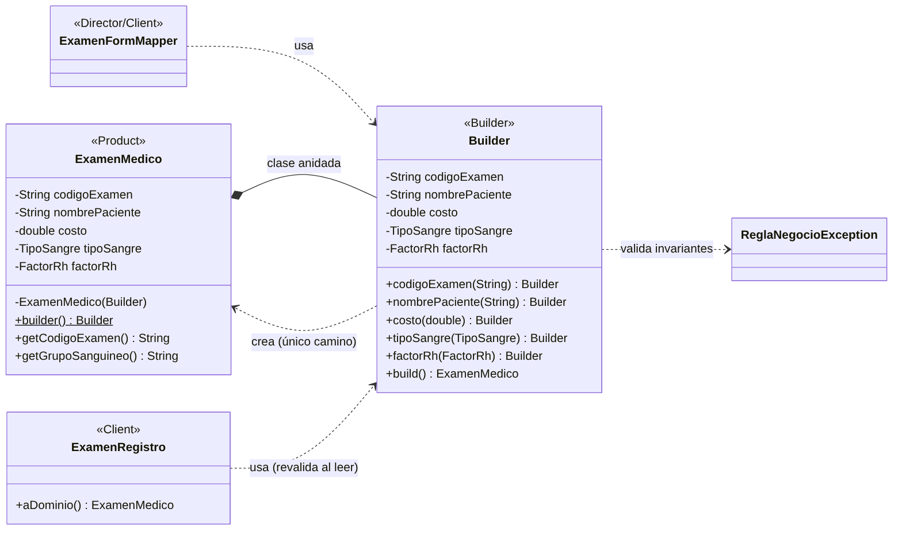
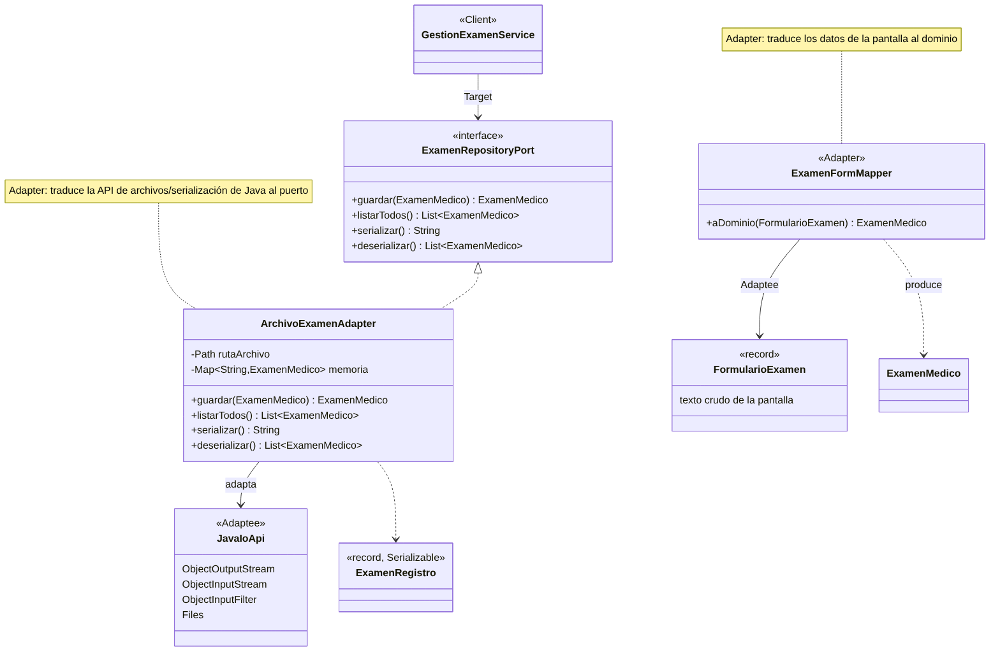
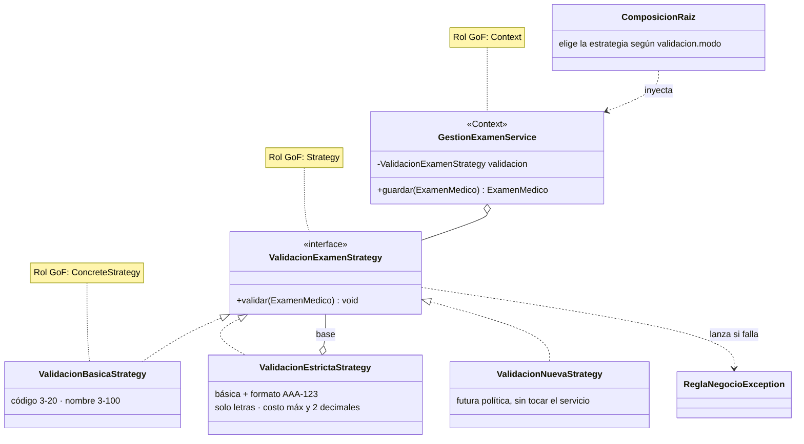

# 3. Patrones de diseño GoF

Se implementan **exactamente tres**, uno por categoría, cada uno atacando problemas concretos del análisis ([01-analisis.md](01-analisis.md)).

| Categoría | Patrón | Clases | Problemas que ataca |
|---|---|---|---|
| Creacional | **Builder** | `ExamenMedico.Builder` | A5 (datos como `String` sueltos), M1 |
| Estructural | **Adapter** | `ArchivoExamenAdapter`, `ExamenFormMapper` | A1, A2, E2, E3 |
| Comportamiento | **Strategy** | `ValidacionExamenStrategy` (+ Básica y Estricta) | E1, C1 |

---

## 3.1 Builder (creacional) — `ExamenMedico.Builder`

**Problema de diseño.** En el original un examen son cinco `String` sueltos leídos de widgets (A5). Construir un objeto con cinco datos obligatorios por constructor es propenso a errores (el orden de los parámetros), y nada impedía que existiera un examen incompleto o con costo negativo.

**Justificación.** El examen tiene varios campos, algunos requieren normalización (código en mayúsculas, espacios del nombre) y todos deben cumplir invariantes **antes** de existir. El Builder permite armarlo campo a campo desde distintas fuentes (formulario, archivo) y centraliza la verificación en `build()`. El constructor de `ExamenMedico` es privado: no hay otro camino para crearlo.

**Cómo está implementado.**
- `build()` recopila **todos** los errores (código, nombre, costo finito y > 0, tipo de sangre, factor RH) y lanza **una** `ReglaNegocioException` con un error por línea.
- Lo usan `ExamenFormMapper` (pantalla) y `ExamenRegistro.aDominio()` (archivo, de modo que se revalida al leer).

**Beneficios frente al diseño original.**
- Es imposible tener un `ExamenMedico` inválido en memoria (invariantes garantizados en un único punto).
- El usuario ve todos los errores a la vez, no uno por intento.
- El código de uso es legible (`.codigoExamen(..).costo(..).build()`) y la entidad queda inmutable.
- Se prueba sin interfaz (`ExamenMedicoTest`).

---

## 3.2 Adapter (estructural) — `ArchivoExamenAdapter` y `ExamenFormMapper`

**Problema de diseño.** Dos "mundos" con interfaces incompatibles con el núcleo: (1) la API de archivos y serialización de Java (`ObjectOutputStream`, `Files`, excepciones `IOException`) y (2) los textos y controles de JavaFX. En el original, ambos quedarían mezclados dentro del controlador (A1, A2, C1); cambiar el formato de archivo (E2) obligaría a reescribirlo.

**Justificación.** El patrón Adapter convierte la interfaz de una clase existente en la que el cliente espera, sin modificar ninguno de los dos lados. Es además el mecanismo natural de la arquitectura hexagonal.

**Cómo está implementado.**
- **`ArchivoExamenAdapter`** adapta la API de Java al puerto `ExamenRepositoryPort` (`guardar`, `listarTodos`, `serializar`, `deserializar`). Traduce `IOException` y datos corruptos a `PersistenciaException`, usa *try-with-resources*, convierte la entidad a `ExamenRegistro` (DTO) y aplica un `ObjectInputFilter` de lista blanca.
- **`ExamenFormMapper`** adapta los datos crudos de la pantalla (`FormularioExamen`: textos, selección del combo, radio) a `ExamenMedico`. Acepta coma decimal y entrega un costo no numérico como `NaN` para que el Builder lo informe con el resto de errores.

**Beneficios frente al diseño original.**
- Los casos de uso no saben que existe un archivo: se puede sustituir por JSON o base de datos escribiendo otro adaptador, sin tocar `GestionExamenService`.
- El controlador no parsea ni persiste: solo lee widgets y delega.
- Los errores técnicos no llegan a la UI: se presentan como mensajes de negocio.
- Ambos adaptadores se prueban sin JavaFX (`@TempDir` para el archivo).

---

## 3.3 Strategy (comportamiento) — `ValidacionExamenStrategy`

**Problema de diseño.** En el original no hay dónde poner las reglas de validación excepto el controlador o el método de guardar (C1), como una cadena de `if/else` que crece con cada regla nueva (E1) y que no se puede variar por entorno (por ejemplo, política laxa en pruebas, estricta en producción).

**Justificación.** Validar es una familia de algoritmos intercambiables bajo una misma interfaz. Strategy permite cambiar la política sin modificar a quien la usa (`GestionExamenService`, el contexto), cumpliendo Abierto/Cerrado.

**Cómo está implementado.**
- `ValidacionExamenStrategy.validar(ExamenMedico)` lanza `ReglaNegocioException` si el examen no es aceptable.
- **`ValidacionBasicaStrategy`**: código de 3 a 20 caracteres; nombre de 3 a 100.
- **`ValidacionEstrictaStrategy`**: todo lo básico (por composición, sin duplicar código) **más** código con formato `AAA-123`, nombre solo con letras, costo ≤ 100 000 000 y máximo dos decimales.
- Ambas acumulan todos los errores.
- `ComposicionRaiz` elige la estrategia según `validacion.modo=estricta|basica` en `application.properties` (o `-Dvalidacion.modo=basica`).

**Beneficios frente al diseño original.**
- Agregar una política es crear una clase (`ValidacionNuevaStrategy`) y elegirla en la raíz de composición: ningún `if` nuevo en servicio ni controlador.
- El servicio se prueba con una estrategia espía o falsa (`GestionExamenServiceTest`).
- La política se cambia por configuración, sin recompilar.

---

## 3.4 Cómo trabajan juntos

`ExamenFormMapper` **(Adapter)** → `ExamenMedico.Builder` **(Builder)** garantiza los invariantes → `GestionExamenService` aplica la `ValidacionExamenStrategy` **(Strategy)** → `ArchivoExamenAdapter` **(Adapter)** persiste. Cada patrón resuelve un problema distinto y ninguno es decorativo: sin ellos habría que volver a meter la lógica en el controlador.

## 3.5 Resumen de mejoras frente al original

| Aspecto | Original | Refactorizado |
|---|---|---|
| Lógica de negocio | Ninguna (handlers vacíos; el controlador sería el único lugar) | En `domain` y `application`, sin JavaFX |
| Acoplamiento | Controlador ↔ widgets ↔ (futura) persistencia | Dependencias hacia el núcleo, inyectadas por constructor |
| Validación | `if/else` en el controlador | Strategy intercambiable y configurable |
| Construcción de datos | `String` sueltos | Entidad inmutable creada con Builder |
| Persistencia | Inexistente / acoplada | Puerto + Adapter sustituible |
| Pruebas | Ninguna | 115 pruebas unitarias, sin necesidad de GUI |
| Documentación | README de *fork* | README, análisis, UML, JavaDoc |
